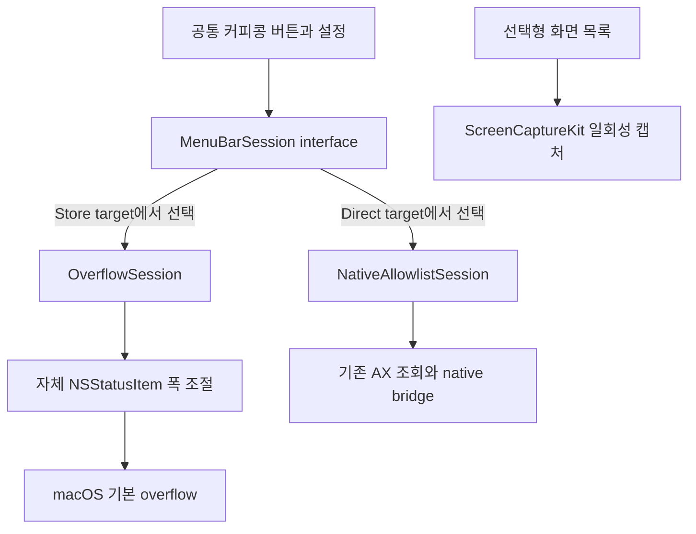

# Barista 공식 출시를 위한 재설계안

작성일: 2026-10-03. 현재 기준 릴리즈: 0.2.1 Preview, macOS 27 / arm64. 이 문서는 **재설계 제안과 실험 결과**이며 출시 승인 또는 전체 구현 완료 기록이 아니다. 생산 소스·설치된 Barista·릴리즈 버전·Git 커밋은 변경하지 않았다.

관련 자료: [플랫폼 조사와 Apple 근거](OFFICIAL_RELEASE_PLATFORM_RESEARCH.md), [현재 구현의 App Store 제약](APP_STORE_FEASIBILITY.md), [Barbee 공개 구현 근거](BARBEE_IMPLEMENTATION_RESEARCH.md), [분리된 실험](../Experiments/OfficialRelease/README.md).

## 결정 제안

**사용자의 추가 요구는 App Store에서도 현재 커피콩 등 선택형 버튼과 거의 동일한 기능·사용감을 유지하는 것이다.** 이를 공식 제품의 목표로 고정한다. 커피콩 디자인은 자체 `NSStatusItem.button.image`로 유지할 수 있지만, OS가 만든 `«`의 모양을 바꾸거나 없애는 공개 경로는 현재 확인하지 못했다. [Apple: NSStatusItem.button](https://developer.apple.com/documentation/appkit/nsstatusitem/button)

Helper 없이 공개 AppKit으로 자체 상태 아이템의 폭을 조정하고 macOS의 `«` overflow를 이용하는 Sandbox 앱은 **기술 연구 후보**로 유지한다. `«`나 큰 빈 공간이 추가되는 결과를 사용자 승인 없이 최종 출시 UX로 채택하지 않는다. 화면 캡처·이미지 인식은 필요한 가치가 확인될 때 추가한다. 사용자가 만족한 작은 커피콩 버튼·직접 배치·접기/펼치기와 자동 접기 동작을 얼마나 유지하는지 먼저 확인한다.

성공 조건은 셋이다. 기술적으로 반복해서 작동해야 하고, 사용자에게 받아들일 외관과 복구 동작이어야 하며, 실제 제출본이 App Review 요구사항을 충족해야 한다. 이 셋은 서로 대신할 수 없다. 현재는 **후보 확보·일부 실험 통과**, 실제 숨김·최종 UX·심사는 **미검증**이다.

사용자는 App Store 출시판에서 현재와 거의 동일한 기능을 원한다고 명확히 했다. 따라서 기능을 줄인 수동-only 제품이나 직접 배포로의 전환을 기본 결론으로 삼지 않는다. 현재 단일 버튼 외관과 핵심 기능을 유지하는 공개 경로를 검증해야 하며, 이 목표를 충족하기 전에는 App Store 출시가 가능하다고 확정하지 않는다.

## 커피콩과 시스템 `«`의 구분

Barista의 버튼은 공개 AppKit의 이미지·target/action으로 구현돼 있다. `CoffeeBeanMark`, `StatusIconStyle`의 디자인과 클릭/우클릭 처리는 Store용에서도 재사용할 후보다. `«`는 overflow가 발생할 때 macOS가 제공하는 별도 시스템 UI다. 제안한 geometry 방식은 **커피콩 클릭→자체 spacer 축소/확장→OS 배치 변경**으로 구성할 수 있으므로 사용자가 반드시 `«`만 눌러야 하는 구조는 아니다. 그러나 접힌 상태에서 OS가 `«`를 함께 표시할 수 있으며, 커피콩 이미지 설정은 그 시스템 버튼을 대체하지 않는다.

설치된 macOS 27 공개 `NSStatusBar.h`, `NSStatusItem.h`, `NSStatusBarButton.h`와 Apple 문서에서 overflow 버튼을 교체·숨기는 interface는 확인하지 못했다. 자신의 `isVisible`이나 `NSMenu.setMenuBarVisible`은 그 목적으로 쓰는 기능이 아니다. 앱의 overlay로 시스템 버튼을 덮는 방법도 실제 숨김·키보드 탐색·화면 변화·심사 문제의 해결책으로 간주하지 않는다. [NSStatusBar](https://developer.apple.com/documentation/appkit/nsstatusbar), [NSStatusItem](https://developer.apple.com/documentation/appkit/nsstatusitem)

현재 기능과 거의 같은지 판정할 우선 항목은 커피콩/다른 스타일 유지, 한 번 클릭으로 접기·펼치기, 정상 메뉴 간격, Command-drag 구역 설정, 메뉴 사용 중 자동 접기 보류, 재부팅·늦게 실행된 앱 처리, 시스템 아이콘 접근/복구다. geometry 실험에서 어느 항목이 달라지는지 실제로 측정한다. 필수 기능이 빠진 결과는 공식 제품 완료로 표시하지 않는다.

## 이전 판단에서 달라진 점

앞선 검토는 현재 `MenuBarClientCore` / `MBAssessmentModeAssertion` bridge와 다른 앱 AX 조회를 바꾸는 경로에 집중했다. 이후 조사로 **단순 10,000pt separator 실패와 모든 geometry 방식 실패를 구분해야 한다**는 근거가 생겼다. MenubarHide는 macOS 27에서 개별 폭을 작게 제한하고 여러 자체 상태 아이템을 함께 늘려 OS overflow로 보내는 구현을 공개했다. 노치와 여러 화면의 폭에 따라 제한값이 달라진다. 이 수치는 Apple가 약속한 계약이 아니라 개발자의 실측이다. [확인한 소스 revision](https://github.com/junior-rj/menubar-hide/blob/6d1a9c50fd939cf1a6c038681037db8f8f748e2f/MenubarHide/CollapsedGeometry.swift), [공개 length 선언](https://developer.apple.com/documentation/appkit/nsstatusitem/length)

minibar 개발자도 macOS 27의 직접 배포본은 앱을 실제 표시 목록에서 제외하는 경로를 쓰고, TestFlight 빌드는 separator와 Apple의 `«`를 사용한다고 구분한다. 이는 배포 형태에 따라 다른 동작을 설계할 실제 사례이며 해당 TestFlight의 현재 심사 완료나 Barista 승인의 증거는 아니다. [minibar 개발자 설명](https://minibar.mintrix.net/)

Barbee의 화면 비교·Helper 존재는 확인됐지만 최신 숨김 API와 Helper entitlement는 여전히 미확인이다. 이를 근거로 같은 private API를 심사에서 쓸 수 있다고 판단하지 않는다.

## 제품과 배포 후보 비교

| 후보 | 유지되는 가치 | 달라지는 점·주요 위험 | 현재 결정 |
| --- | --- | --- | --- |
| A. Sandbox geometry + OS overflow | 클릭으로 정리/복원, 사용자 Command-drag, 커피콩 디자인, 로그인 실행 | separator·넓은 빈 공간·`«` 가능, 화면별 길이 임계치가 미문서화, 외부 메뉴 사용 감지의 정밀도 변화 | **우선 연구·실기 검증** |
| B. A + 선택형 캡처 목록 | A의 기본 동작 + 시각적 목록/진단 | 화면 권한, 동적 아이콘·중복 이미지·소유자 불명, 화면에 없는 아이콘을 캡처할 수 없음 | 목록 가치가 확인된 뒤 |
| C. Store 앱 + 외부 companion | 외부 엔진에 AX 등 기능을 맡길 기술적 가능성 | 2중 설치·권한·IPC·업데이트·심사 조건; public-only 요구도 별도 | 1.0 기본 구조에서 제외 |
| D. Developer ID 직접 배포 | 현재 단일 버튼·간격과 기존 동작을 가장 많이 유지 | private API 의존·OS 업데이트 회귀, 서명·공증·업데이트 구축 | A가 UX/기술 관문 실패할 때 선택지 |

Apple DTS는 Sandbox 앱의 `SMAppService`→nonsandbox job 등록을 지원하지 않는다고 설명한다. 별도 설치된 companion과의 App Group IPC 자체는 지원될 수 있으며, 그 제품의 Store 승인에 대해서는 판단을 분리한다. 따라서 C는 불가능하다고 단정하지 않되, 출시의 기본 전제로 삼지 않는다. [등록 조건](https://developer.apple.com/forums/thread/802443), [독립 companion IPC와 심사 구분](https://developer.apple.com/forums/thread/845853)

## 첫 공식 제품의 범위

1. 사용자가 Command-drag로 구역을 정하고 커피콩 버튼으로 접거나 펼친다. 실제 경계가 커피콩인지 별도 divider인지는 실기 실험 뒤 확정한다. 기본 아이콘 스타일과 설정을 재사용한다.
2. 첫 프로토타입 관문은 **수동 접기/펼치기가 완전하게 작동하는 것**이다. 공식 제품에는 현재 자동 접기와 다른 앱의 열린 메뉴를 방해하지 않는 동작의 동등성 검증이 필요하다. 포인터가 막대 밖에 있다는 이유만으로 사용이 끝났다고 판단하지 않는다. 수동-only 프로토타입의 성공을 사용자 요구를 충족한 출시판으로 취급하지 않는다.
3. OS의 `«`에 들어간 아이콘을 사용자가 실제로 클릭할 수 있어야 한다. 펼치기·종료·재실행·권한 철회·디스플레이 변경에 복구 경로를 제공한다.
4. 새 앱 아이콘이 어느 구역에 나타나는지 검증하고 설정에서 그 동작을 설명한다. geometry에서 bundle ID 기반 자동 분류·숨김 개수·개별 시스템 아이콘 숨김을 확인 없이 제공하지 않는다.
5. 첫 지원 범위는 검증된 macOS 27 / Apple Silicon으로 유지한다. macOS 26·Intel·다중 화면 지원은 각 실기 결과를 얻은 뒤 확대한다. 컴파일 target 변경만으로 지원 OS가 늘어나지 않는다.
6. Helper·일반 스크립트 설치·화면 캡처·원격 서버를 기본 설치 단계에 넣지 않는다. 선택형 목록 기능은 거절해도 기본 정리 기능을 쓸 수 있게 한다.

가격과 기능 확장은 기본 숨김의 신뢰성이 확인된 뒤 결정한다. 지금은 공식 제품의 최소 약속을 먼저 고정한다.

## 코드 구조: 엔진의 interface를 실제 동작에 맞춘다

현재 `AppDelegate`는 사용자 입력·환경 관찰·AX scan·앱/시스템 선택·비공개 assertion·지연/복구를 함께 관리한다. `MenuVisibilityControlling.restrict(allowedBundleIDs:hiddenSystemIDs:)`는 allowlist 엔진에는 맞지만 geometry 엔진에 맞지 않는다. geometry를 이 interface에 억지로 넣으면 스크린샷을 bundle ID로 매핑하는 불필요한 복잡성이 생긴다.

제안하는 **외부 seam은 `MenuBarSession`의 작은 interface**다. UI는 아래 작업과 관찰 상태만 안다. 구현 내부에서 각 backend의 식별·크기·요청 순서·복구·타이머를 관리한다.

```swift
@MainActor
protocol MenuBarSession: AnyObject {
  var state: SessionState { get }
  func perform(_ action: SessionAction) async -> SessionState
}
// action: reveal, collapse, reset
// state: mode, inFlight, capability, blockedReason, layoutRevision
```

이 선언은 설계용 스케치이며 구현한 protocol이 아니다. `perform`의 interface 계약은 다음과 같다.

- 실패 또는 지원 불명 상태는 펼침/복구를 우선하고, 성공 전에는 UI를 접힘 상태로 표시하지 않는다.
- 마지막 사용자 의도가 이전 async 작업보다 우선한다. 요청 revision이 달라지면 늦은 완료가 상태를 덮지 못한다.
- display·Space·잠금·로그인 상태 변화는 기존 좌표/식별 snapshot을 무효화한다. 새로운 collapse 전에 geometry를 재평가한다.
- 지원 범위는 backend별로 명시한다. `Native allowlist`는 bundle 단위지만 `OS overflow`는 위치 구역 단위다. 숨김 개수/앱별 설정을 capability 없이 공유하지 않는다.
- unknown interaction 상태에서 자동 collapse는 보류한다. 사용자의 명시적 collapse와 자동 collapse를 구분한다.
- `reset`은 임시 길이·모니터·타이머·pending 작업을 제거한다. 앱 종료/engine 오류 시에도 호출하며, crash 시 OS 복구는 별도 실기 검증한다.

실제 다른 두 adapter가 있으므로 seam의 이유가 분명하다. `NativeAllowlistSession`은 현재 direct build의 동작을 감싸고, `OverflowSession`은 자체 상태 아이템과 OS overflow를 관리한다. UI가 backend별 알고리즘을 직접 분기하지 않는다.



선택은 각 target의 소스 포함 목록으로 고정한다. Store 앱에 native bridge를 포함해 두고 실행 중 감춰 놓는 설계가 아니다. 이 그림은 최종 구현의 목표 구조다.

| 현재 코드 | 이동·재사용 방향 |
| --- | --- |
| `MenuVisibilityBridge`, `HiddenSelection`, `MenuItemDiscovery`, `SystemItemCatalog` | 직접 배포 adapter 내부로 묶음. Store target에서 제외 |
| `MenuInteractionMonitor`, `SystemMenuArea` | 현 AX 구현은 direct 내부. Store 구현은 별도 public 관찰로 검증; 미검증 동안 자동 접기 비활성 |
| `AppDelegate`의 launch scan/retry·requestNumber·activationTimer | native adapter와 공통 session coordinator에 책임별로 이동. geometry에 앱별 재분류 루프를 복제하지 않음 |
| `StatusIconStyle`, `CoffeeBeanMark`, `AutoCollapseDelay`, 설정 UI | 제품 UI로 재사용하되 capabilities에 따라 표현·선택지 조정 |
| 로그인 등록 | `SMAppService.mainApp` 유지. companion 등록과 혼동하지 않음 |
| 기존 Layout/Startup/Interaction checks | native adapter 회귀를 유지. overflow는 실제 화면·item 복구에 맞는 별도 검사 |

새 interface를 만들면서 현재 실행 중인 앱을 교체하지 않는다. 실험→실기 결과→adapter 추출→제품 target 순서로 진행한다. 모듈을 여러 pass-through protocol로 나누기보다, OS 의존성이 있는 두 adapter와 사용자 의도를 처리하는 coordinator에 집중한다.

## 이미지 인식은 선택형 별도 모듈

스크린샷에는 앱의 bundle ID가 포함되지 않는다. macOS 27에서 메뉴 막대 전체가 하나의 창이면 `SCWindow.owningApplication`으로 아이콘별 앱을 알아낼 수 없다. OS가 그리지 않은 아이콘도 단순 crop으로 복구되지 않는다. [SCWindow](https://developer.apple.com/documentation/screencapturekit/scwindow)

따라서 초기 화면 기반 결과는 `VisualItem`으로 저장한다: 임시 visual ID, 사용자 이름, point 좌표, display ID/scale, theme, captureRevision, confidence, optional confirmedBundleID. bundle ID는 별도의 확정 근거가 있을 때만 붙인다. 중복·애니메이션·숫자 변화는 ambiguity로 유지한다.

권장 capture 흐름은 사용자가 목록을 요청했을 때 1회 읽기→상단 영역 정규화→아이콘 후보 분할→사용자 확인이다. 원본 이미지는 메모리에만 두고 모듈이 닫히거나 권한이 철회되면 버린다. 이미지 매칭 실패가 기본 hide/reveal을 막지 않게 한다. 클릭을 다른 앱에 전달하거나 아이콘을 자동 드래그하는 기능은 `CGEventPost`의 Sandbox 지원·TCC·정책을 별도로 검증한 뒤 논의한다. Input Monitoring 성공은 합성 입력 허가가 아니다.

## 실행한 실험과 정확한 한계

실험 소스는 `Experiments/OfficialRelease/`에 있으며 기존 `Sources/Barista`와 빌드 scripts에는 연결하지 않았다.

| 확인 항목 | 실제 결과 | 증명하지 않는 것 |
| --- | --- | --- |
| `OverflowPlan` | 비노치·노치·혼합 화면 4가지 제안과 invalid/용량 부족 입력 검사 통과 | 경험적 임계값의 실제 정확성·다른 앱 숨김 |
| 공개 screenshot 선언 | Swift 6 / SDK 27 / arm64 타입 검사 통과 | entitlement·TCC·실제 아이콘 식별 |
| 실험 앱 서명 | ad-hoc + hardened runtime + `app-sandbox=true` 단일 entitlement, strict signature 검사 통과 | Developer ID, Store distribution profile, 심사 |
| Sandbox runtime 진단 | macOS 27.0.1 / 26A434, `sandboxContainer=dev.eden.barista.research.geometry` 확인 | clean install 환경 또는 다른 기기 |
| 권한 preflight | capture=true, listen=false, post=false; 화면 폭 1680pt, 노치 없음 | false의 원인이 Sandbox 금지라는 결론; 실제 합성 입력 가능 여부 |
| capture transport | 사전 권한 확인 뒤 `(0,0,1,1)` points 일회성 메모리 캡처 성공, 2×2 pixels | 메뉴 crop·아이콘 인식·가려진 아이콘·팝업 활성화 |
| 공개 링크·금지 기능 조사 | lab은 AppKit/CoreGraphics/Foundation/ScreenCaptureKit 공개 frameworks, 소스에 AX/private bridge/합성 입력 호출 없음 | 전체 제출본 감사 또는 App Review 통과 |
| 실제 overflow layout | **실행하지 않음**. 별도 lab UI와 5초 자동 복구 trial 준비 | 다른 앱 아이콘 이동/복원·current UX 유지 |

진단 앱은 shell에서 실행했다. 호스트의 기존 화면 권한/TCC responsible-process 처리가 영향을 줄 수 있어 깨끗한 독립 설치의 권한 흐름을 검증했다고 표현하지 않는다. capture 파일은 저장하지 않았고 입력 관찰·전달 권한을 요청하지 않았다. 외부 실행 제한 안에서는 프로세스가 중단됐고, 제한 밖 진단 실행에서 위 결과를 얻었다. GUI trial은 충돌을 줄이기 위해 알려진 다른 메뉴 관리자가 실행 중이면 거부한다. 현재 앱을 대신 종료하거나 레이아웃을 자동 변경하지 않았다.

geometry 계산은 참고 소스의 경험적 한도를 연구 가설로 사용했지만 별도로 작성했다. 작거나 극단적으로 다른 화면에서 무조건 minimum 200pt 또는 max 7개로 잘라 숨김 성공처럼 표시하는 대신, 안전 여유 64pt를 빼고 최소 32pt/최대 7개를 만족하지 못하면 unsupported를 반환한다. 이 역시 아직 실측으로 보장되지 않는 실험 정책이다.

## 실제 구현으로 진행할 관문

| 순서 | 할 작업 | 통과 조건 | 실패 시 |
| --- | --- | --- | --- |
| G1 기본 geometry | 다른 관리자를 끈 분리된 테스트에서 실제 다른 앱 아이콘을 왼쪽/오른쪽으로 배치 | 왼쪽만 overflow 이동, 오른쪽·커피콩 접근 유지, reveal·quit·crash 복구 반복 확인 | A의 기본 feasibility 재검토; UX 또는 D 선택 |
| G2 화면/OS | 노치 + 외부 화면, 전면 앱 메뉴 길이, 해상도·Space·전체 화면·자동 숨김·hot plug | 아이콘이 영구 유실되지 않음, 부족한 geometry는 복구·지원 불가 안내 | 지원 범위 제한 또는 엔진 폐기 |
| G3 설치/startup | clean user/실제 배포 서명, cold launch, 로그인 지연 앱, 새 아이콘, reboot | 자발적으로 정리한 배치가 유지되고 숨긴 항목을 항상 찾을 수 있음 | 초기 펼침 유지·새 앱 규칙 수정 |
| G4 제품 UX | divider/blank gap/`«`를 사용자가 평가 | 현재 만족한 작은 앱의 목적이 유지됨; 추가 공간 비용 수용 | 공식 direct build 선택 또는 범위 조정 |
| G5 관찰/자동접기 | public-only 감지로 실제 타 앱 메뉴/팝오버 사용 | 클릭·스크롤·키보드 탐색 도중 숨김 없음; unknown은 보류 | 현재와 동등한 출시 목표 미달로 기록; 기능 축소를 자동 채택하지 않음 |
| G6 제출 target | Sandbox Store target에서 current native/AX 코드가 compile/link되지 않도록 whitelist | 최종 바이너리·entitlement·실행 감사, 외부 helper 없이 advertised 기본 기능 작동 | 의존 제거 또는 Store 후보 중단 |
| G7 배포/심사 | 실제 Apple Distribution 또는 Developer ID, onboarding·privacy·리뷰 안내·검증 환경 | 각 배포 채널의 실제 서명·공증/심사·업데이트 검증 | Preview 유지; 공식 출시 표시 보류 |

G1–G4는 구현 완료 후 다시 묻는 형식이 아니라, 사용자에게 **실제로 동작하는 두 UX**를 보여 주고 선택할 수 있는 관문이다. G5·선택형 캡처 때문에 G1을 미루지 않는다. 금지 private 문자열 검색만으로 감사를 마치지 않고, 소스 포함 목록·동적 호출·링크·entitlement·실행 경로를 함께 확인한다.

처음 네 관문이 통과하면 작은 Store beta를 만들 수 있다. TestFlight 배포를 최종 Store 승인으로 취급하지 않으며, 실제 심사에는 geometry 동작·지원 OS·권한 사용·실제 복구 방법을 공개한다. Apple 문의 초안은 플랫폼 조사에 준비했다. 제3자에게 아직 메시지를 보내지 않았다.

## 공식 릴리즈 준비에서 추가로 필요한 것

현재 `scripts/build.sh`는 `Sources/Barista/*.swift` 전체를 compile하고, 서명 identity가 없으면 ad-hoc으로 만든다. `release.sh`는 27.0·arm64 ZIP과 SHA256SUMS를 만든다. 이 경로에 Sandbox entitlement만 덧붙여 Store build라고 부르지 않는다.

Store와 Direct는 명시적인 source 포함 목록·entitlements·서명/배포 설정을 가진 별도 targets로 만든다. Store는 public-only adapter와 app bundle/provisioning을 검증하고 Store 업데이트를 사용한다. Direct는 Developer ID Application/hardened runtime/notarization/stapling과 실제 다운로드 환경 설치·업데이트를 검증한다. 공증은 private API의 안정성을 보장하지 않는다. [Apple 배포 준비](https://developer.apple.com/documentation/xcode/preparing-your-app-for-distribution)

서명 identity·Developer 계정·App Store Connect 설정은 아직 검증하지 않았다. 현재 lab은 기존 `dev.eden.barista`와 다른 연구 전용 bundle ID를 사용한다. 최종 제품의 bundle ID·기존 설정/로그인 항목 migration·두 채널의 교체 정책은 beta 이전에 결정하며, 둘을 동시에 실행하지 않도록 한다. 이전 ad-hoc 권한이 새 서명 제품으로 자동 이전된다고 약속하지 않는다.

공식 1.0.0은 위 관문과 소비자 설치·복구 절차가 충족된 뒤 정한다. 이번 조사만으로 Preview 버전을 올리거나 기존 릴리즈를 다시 게시하지 않는다.
